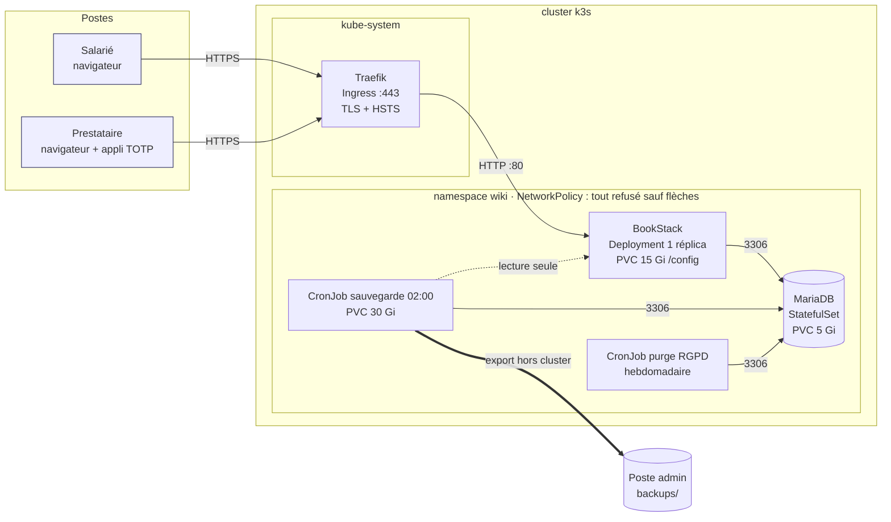
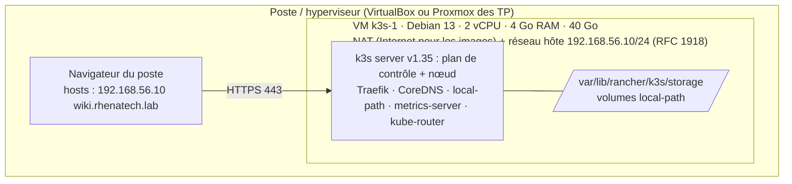

# Note de cadrage — « Ce que nous allons faire »

**SAÉ5.DevCloud.03 · BookStack chez Rhénatech · interlocutrice : Claire Fischer (responsable infrastructure)**
Soutenance : 22/01/2027 · dossier : 20/01/2027 23 h 59 · dépôt : ce dépôt Git.

## 1. Le besoin, dans nos mots

Rhénatech (140 salariés, 60 clients) fait intervenir 25 techniciens de trois sous-traitants la nuit
et le week-end. Sa documentation est éparpillée (PDF par courriel, partage réseau, boîtes mail) :
en septembre, une procédure périmée a coupé le réseau des urgences d'une clinique pendant 4 h.

Nous construisons la **maquette d'une base documentaire unique, hébergée chez Rhénatech**, sur
BookStack conteneurisé et orchestré par **Kubernetes (k3s)**, avec deux publics strictement séparés :

- les **salariés** voient ce qui les concerne (administrateurs, éditeurs, lecteurs) ;
- les **prestataires** ne voient **que** les procédures d'intervention et les fiches **de leurs clients**,
  avec un compte nominatif, une **double authentification TOTP** et une désactivation en fin de contrat.

Tout doit être **reproductible** : le dépôt Git suffit pour réinstaller la plateforme de zéro,
**en une commande**, et une restauration de sauvegarde est **testée et chronométrée**.

## 2. Ce que nous livrons

| Livrable | Contenu | Besoins couverts |
|---|---|---|
| Socle k3s | namespace `wiki`, Ingress HTTPS `wiki.rhenatech.lab`, ConfigMap/Secret, PVC dimensionnés | B1, B9, ET1-ET5 |
| Application | BookStack + MariaDB (images épinglées), sondes, requests/limits, NetworkPolicy | B8, B10, ET6, ET7 |
| Sécurité | 4 profils + un rôle d'accès par client, cloisonnement par livre, TOTP obligatoire, journal d'audit, purge RGPD | B2-B7, B12, ET9 |
| Exploitation | CronJob de sauvegarde, export hors cluster, restauration chronométrée, mise à jour / retour arrière, état en 1 min | B11, B13, B14, ET8, ET10 |
| Recette | script `recette.sh` exécutant R1 à R12, journal daté | R1-R12 |
| Dossier + oral | cahier des charges technique (≤ 20 p.), diaporama, démonstration | — |

Hors périmètre de la maquette (traités en « limites et suite » ou en option si le temps le permet) :
annuaire LDAP/OIDC (B15, O2), serveur de courriel de test (B16, O3), supervision Prometheus (O4),
haute disponibilité à deux réplicas (A3).

## 3. Architecture

### Schéma logique

### Schéma physique (maquette)

Variante à trois VM (k3s-1 serveur, k3s-2 et k3s-3 agents, 2 Go chacune) pour montrer la panne
d'un nœud : avec local-path, le volume reste lié à son nœud (point d'attention documenté, parade = A3).

### Choix structurants (détaillés et justifiés dans le dossier, partie 3)

| Question | Choix | Écarté |
|---|---|---|
| Orchestrateur | k3s (léger, Traefik + stockage + NetworkPolicy intégrés) | Docker Compose (étape, pas livraison), kubeadm |
| Image BookStack | `lscr.io/linuxserver/bookstack` épinglée | image `solidnettech` (moins suivie) |
| MariaDB | StatefulSet 1 réplica | Deployment |
| BookStack | Deployment 1 réplica, stratégie Recreate | RollingUpdate (deux pods sur un volume RWO) |
| Déploiement | Kustomize (`kubectl apply -k`) + script | Helm (option O1) |
| Stockage | local-path (PVC) | NFS / Longhorn (mémoire, complexité) |
| TLS | autorité interne générée par script | Let's Encrypt (impossible en `.lab`), auto-signé simple |
| Cloisonnement | rôle Prestataire sans droits + un rôle par client, permissions par livre | un rôle par sous-traitant (trop grossier) |

## 4. Planning par jalon (point tous les 7 jours)

| Semaine | Jalon | Résultat attendu | Preuve |
|---|---|---|---|
| S1 (cette semaine) | **Cadrage** | cette note validée, architecture logique/physique, dépôt Git créé | note validée « oui » |
| S2 | **Socle infra** | cluster k3s, namespace, Ingress + certificat HTTPS, ConfigMap/Secret, PVC | R1, `kubectl get all,pvc,ingress` |
| S3 | **BookStack + MariaDB** | images versionnées, sondes, NetworkPolicy, premier accès au wiki | R7, R8 |
| S4 | **Rôles et sécurité** | 4 profils, cloisonnement des étagères, TOTP, journal d'audit | R2 à R5 |
| S5 | **Exploitation** | CronJob de sauvegarde, restauration testée et chronométrée, mise à jour / retour arrière | R6, R10, R11, R12 |
| S6 | **Recette et rédaction** | R1 à R12 exécutés et datés, cahier des charges complété au fil de l'eau | `docs/recette/journal-*.md` |
| S7 | **Finalisation** | relecture du dossier, diaporama, répétition de la démo (10 min) | dossier remis le 20/01 |

Règle de travail : chaque jalon ajoute sa partie au cahier des charges (`docs/cahier-des-charges/`)
et ses tests au journal de recette ; un blocage est signalé tout de suite dans les échanges du projet,
avec la sortie de `kubectl describe` et des journaux.

## 5. Risques identifiés dès le cadrage

| Risque | Effet | Parade prévue |
|---|---|---|
| Horloge de la VM qui dérive (mise en veille du PC) | tous les codes TOTP refusés (RFC 6238) | NTP activé, vérifié dans la procédure ; démontré par la recette (code décalé de 120 s refusé) |
| Perte de l'`APP_KEY` | TOTP et sessions illisibles | Secret généré une fois, sauvegardé hors ligne, jamais dans Git |
| `APP_URL` différente de l'adresse réelle | redirections en boucle, images cassées | `APP_URL=https://wiki.rhenatech.lab` exactement |
| Volume local lié à un nœud | panne du nœud = service arrêté jusqu'à restauration | assumé et chiffré (restauration < 2 min mesurée), parade A3 décrite |
| Mise à jour qui migre la base | retour arrière impossible par simple changement d'image | sauvegarde automatique avant chaque mise à jour, retour = image + restauration |
| Secret poussé dans Git | fuite | `.gitignore`, `secret.exemple.yaml` factice, contrôle `git grep` (R9) |
