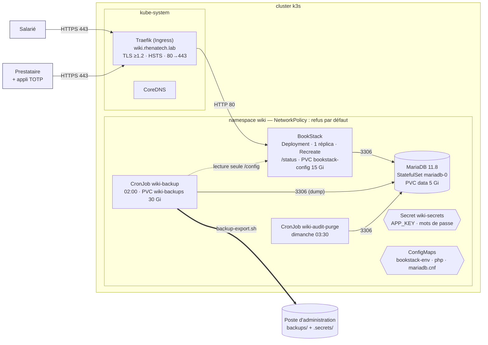
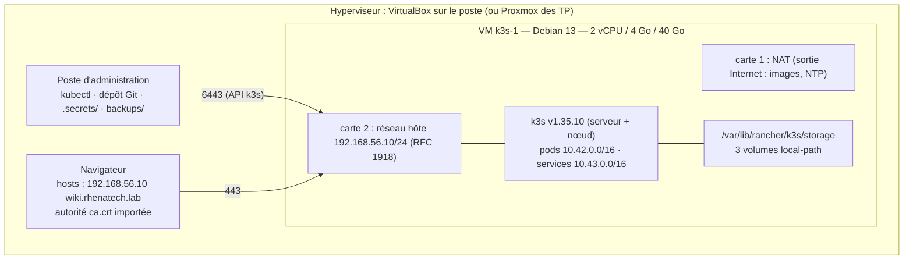

# 2. Architecture

## 2.1 Schéma logique

## 2.2 Schéma physique

Variante à trois nœuds (même dépôt, sans modification) : k3s-1 serveur 192.168.56.11, k3s-2 et k3s-3
agents 192.168.56.12-13. Les pods suivent leur volume local-path (affinité de nœud posée par le provisionneur).

## 2.3 Matrice des flux (= NetworkPolicy de `k8s/networkpolicies.yaml`)

| Source | Destination | Port | Pourquoi | Contrôle |
|---|---|---|---|---|
| Postes | Traefik (nœud) | 443/TCP, 80/TCP | accès au wiki ; 80 ne fait que rediriger | Ingress `wiki`, `wiki-http-redirect` |
| Traefik (kube-system) | bookstack | 80/TCP | proxy inverse (TLS terminé par Traefik) | `bookstack-from-traefik` |
| bookstack | mariadb | 3306/TCP | base de l'application | `bookstack-to-mariadb`, `mariadb-from-clients` |
| jobs `wiki-backup`, `wiki-maintenance` | mariadb | 3306/TCP | sauvegarde, restauration, purge RGPD | `jobs-to-mariadb`, `mariadb-from-clients` |
| tous les pods du namespace | CoreDNS | 53/UDP+TCP | résolution de noms | `allow-dns-egress` |
| tout le reste (entrant et sortant, dont Internet) | — | — | refusé | `default-deny-all` |

BookStack n'a **aucune sortie Internet** : `AVATAR_URL=false` coupe Gravatar, le courriel est journalisé.
